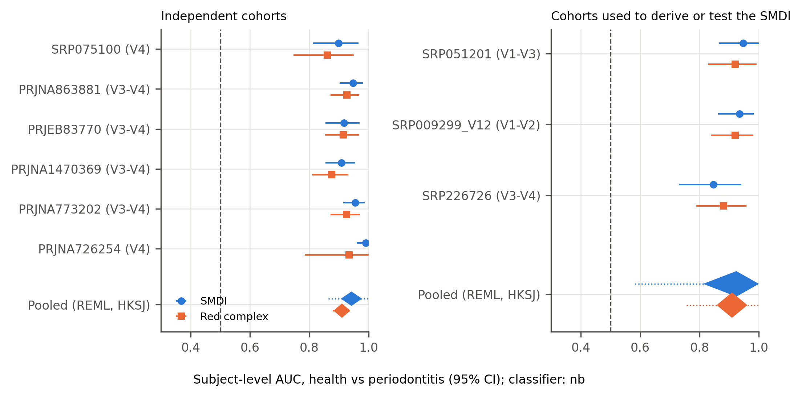

# Multi-cohort external validation

This page reports how the outputs of `q2-periobiome` behave on public
subgingival 16S rRNA data processed from raw reads. The analysis followed
a plan written before the new cohorts were processed
([ANALYSIS_PLAN.md](ANALYSIS_PLAN.md)); every departure from it is listed
under [Deviations from the plan](#deviations-from-the-plan).

* Every number below is produced by `validation/analysis/` and is in
  [`validation/results/`](../validation/results/): `REPORT.md` (all
  tables, both classifiers), `tables/*.tsv` and `figures/`.
* How to reproduce it: [`validation/README.md`](../validation/README.md).
* The validation was run while the plugin was still called
  `q2-periodontitis`; the code of the actions is the same.

## Summary

* **Health vs periodontitis.** In six independent case-control cohorts, the
  SMDI, SMDI_simplified, the Red complex and PC2014_moderate were
  consistently higher in periodontitis than in periodontal health (pooled
  AUC 0.90–0.94), although individual values overlapped between groups.
  The early-colonizer complexes, above all Blue (*Actinomyces*), were
  consistently lower.
* **SMDI vs Red complex.** The SMDI discriminated slightly better than the
  Red complex alone (pooled ΔAUC +0.023, 95% CI 0.008–0.038).
  SMDI_simplified did not differ from it.
* **Severity.** The SMDI correlated with probing depth, attachment loss and
  bleeding on probing (ρ 0.60–0.76) in the two cohorts with clinical data,
  and with periodontitis stage (ρ 0.52–0.58) in two of three.
* **Therapy.** The median SMDI fell after periodontal therapy in all six
  treated cohorts or arms (p < 0.05 in four); in an untreated control arm
  it rose.
* **Prognosis.** Baseline values did not identify non-responders
  (AUC ≈ 0.5).
* **Robustness.** Results were stable across taxonomic classifiers, 16S
  regions, rarefaction depths and pseudocounts. The value of the SMDI,
  however, shifts with region and pseudocount, so published cut-offs do
  not transfer exactly.

## Questions

| | Question | Unit | Section |
|---|---|---|---|
| Q1 | Do the indices discriminate periodontitis from health? | subject | [Q1](#q1-health-vs-periodontitis) |
| Q2 | Does the SMDI discriminate better than the Red complex? | subject | [Q2](#q2-smdi-vs-red-complex) |
| Q3 | How do the published cut-offs perform? | subject | [Q3](#q3-published-cut-offs) |
| Q4 | Do the indices change after therapy? | subject or site | [Q4](#q4-change-after-therapy) |
| Q5 | Do baseline values predict non-response? | site or subject | [Q5](#q5-prognosis) |
| Q6 | Do the indices track clinical severity? | subject | [Q6](#q6-clinical-severity) |

## Cohorts

16 datasets from 14 sets of samples (PRJNA773195 re-sequences the samples
of PRJNA773202 in another region, and SRP009299 has V1-V2 and V4 reads of
the same libraries). The full register, with publications, is in
[`validation/README.md`](../validation/README.md) and
[`validation/cohorts.tsv`](../validation/cohorts.tsv).

| Role | Cohorts |
|---|---|
| Primary meta-analysis (independent of the SMDI) | SRP075100 (V4), PRJNA863881 (V3-V4, Spain), PRJEB83770 (V3-V4, France), PRJNA1470369 (V3-V4, China), PRJNA773202 (V3-V4, Spain/Portugal), PRJNA726254 (V4, USA) |
| Non-independent (SMDI training or test data) | SRP051201 (Kirst 2015), SRP009299 V1-V2 (Griffen 2012), SRP226726 (Pei 2020) |
| Region comparison only | PRJNA773195 (V1-V3), SRP009299 V4 |
| Severity only (gingivitis vs stage II-IV) | PRJNA1294584 (Thailand) |
| Therapy and prognosis | PRJNA786436, PRJNA736618, PRJEB106816, SRP062274, plus the follow-up samples of SRP075100 and PRJNA726254 |

"Independent" means that no sample of the cohort was used to derive or
test the SMDI (Chen et al. 2022 trained it on Abusleme 2013, Griffen 2012
and Kirst 2015, and tested it on Pei 2020, Bizzarro 2016 and HMP).

## Processing

* QIIME 2 amplicon 2024.10. Reads were downloaded from ENA with MD5
  checks, and pre-processing was fixed per cohort from read quality,
  before any index was computed (`validation/configs/`).
* Primers were removed with cutadapt where they were present, and reads
  were denoised with DADA2. The exception is SRP009299, which was deposited
  without real quality scores and was denoised with Deblur.
* Taxonomy: naive Bayes classifiers trained on eHOMD 16S RefSeq V15.23,
  trimmed to each primer pair (primary). Every analysis was repeated with
  `classify-consensus-vsearch` against full-length eHOMD (≥ 98% identity).
* `collapse-complexes` ran with default parameters (published
  table-dependent pseudocount).
* Several samples of one subject at one time point were averaged. AUC 95%
  CIs come from a stratified bootstrap over subjects (2,000 resamples).

### Quality control (naive Bayes)

| Measure | Range across the 16 datasets (median per dataset) |
|---|---|
| Reads per sample | 1,569–176,948 |
| Reads in a Socransky complex | 0.07–0.35 |
| Reads named to species | 0.53–0.94 |
| SMDI species absent from the table | 1–22 of 49 |

The Socransky panel covers only 20–35% of the reads in most cohorts.
Three non-independent datasets were flagged by the pre-specified QC rules
(SRP051201, SRP009299: median depth < 5,000; SRP226726: < 10% of reads
assigned). None of the six primary cohorts was flagged.

**Species resolution in V4.** Oral *Streptococcus* (Yellow) and
*Actinomyces* (Blue) are poorly resolved to species in V4. The Yellow
complex is therefore underestimated in V4 data, and several health-
associated SMDI species are missing (e.g. 16 of 49 in SRP075100). Prefer
V1-V3 or V3-V4 when the early-colonizer complexes matter, and always
report the `qc_*` columns and the absent-taxa warning.

## Q1. Health vs periodontitis

Random-effects meta-analysis of the AUC: REML with Hartung-Knapp-Sidik-
Jonkman confidence intervals, Hanley-McNeil standard errors. AUC is
P(index in periodontitis > index in health); values below 0.5 mean higher
in health.

| Measure (6 independent cohorts, naive Bayes) | Pooled AUC (95% CI) | 95% prediction interval | I² |
|---|---|---|---|
| **SMDI** | **0.94 (0.91–0.98)** | 0.86–1.00 † | 52% |
| SMDI_simplified | 0.92 (0.89–0.94) | 0.89–0.94 | 0% |
| Red complex | 0.91 (0.88–0.94) | 0.88–0.94 | 0% |
| PC2014_moderate | 0.90 (0.86–0.94) | 0.82–0.98 | 31% |
| Orange complex | 0.72 (0.62–0.81) | 0.49–0.94 | 68% |
| Purple complex | 0.36 (0.25–0.47) | 0.10–0.62 | 62% |
| Green complex | 0.27 (0.14–0.40) | 0.00–0.58 † | 77% |
| Yellow complex | 0.19 (0.11–0.26) | 0.02–0.35 | 51% |
| Blue complex | 0.18 (0.13–0.24) | 0.12–0.24 | 7% |

† Limit truncated to [0, 1], the attainable range of an AUC; the raw
limits are in `meta_auc.tsv` (`*_raw` columns).

Per cohort, the SMDI AUC ranged from 0.90 to 0.99. Sensitivity analyses
gave the same picture:

* DerSimonian-Laird or bootstrap standard errors: within 0.01 of the
  primary estimates;
* leaving out one cohort at a time: SMDI between 0.93 and 0.95;
* the vsearch classifier: SMDI 0.93 (0.91–0.96);
* the same model on logit(AUC): SMDI 0.93 (0.89–0.95), Red 0.90
  (0.86–0.93).

In the three non-independent datasets, the SMDI reached a pooled AUC of
0.92 (0.81–1.00) and the Red complex 0.91 (0.86–0.96). Independent data
therefore reproduce, and do not fall short of, the accuracy that Chen et
al. (2022) reported (0.92 in their test sets).

The complexes behave as the Socransky model predicts: the late colonizers
(Red, and less consistently Orange) are higher in periodontitis, and the
early colonizers are lower, most consistently Blue (*Actinomyces*). This
replicates the disease association of the complexes. It does not test
their co-occurrence structure, which is how they were defined.

## Q2. SMDI vs Red complex

Paired DeLong test per cohort, then random-effects pooling of the AUC
difference (independent cohorts, naive Bayes):

| Comparison | Pooled ΔAUC (95% CI) | p | I² |
|---|---|---|---|
| SMDI − Red | +0.023 (0.008 to 0.038) | 0.012 | 0% |
| SMDI_simplified − Red | +0.002 (−0.017 to 0.022) | 0.80 | 0% |

No single cohort showed a significant difference after correction. The
49-species index adds a small and consistent gain over the three Red
complex species; the three-genus index adds none.

## Q3. Published cut-offs

Pooled sensitivity and specificity (DerSimonian-Laird random effects on
the logit scale, six independent cohorts, naive Bayes):

| Rule | Sensitivity (95% CI) | Specificity (95% CI) |
|---|---|---|
| SMDI > 0 | 0.90 (0.86–0.94) | 0.69 (0.57–0.79) |
| SMDI > 0.4 (best in training) | 0.88 (0.80–0.93) | 0.77 (0.67–0.85) |
| SMDI > 0.5 (best in test) | 0.87 (0.79–0.93) | 0.81 (0.69–0.89) |
| SMDI_simplified > 0 | 0.75 (0.57–0.88) | 0.82 (0.70–0.90) |

Even at the best published cut-off, about one in eight patients and one in
five healthy subjects are misclassified, and the specificity varies
between cohorts. The cut-offs describe groups; they do not classify
individuals reliably.

## Q4. Change after therapy

Follow-up minus baseline, Wilcoxon signed-rank test (naive Bayes):

| Cohort | Treatment | Follow-up | n | Median ΔSMDI | Decreased | p |
|---|---|---|---|---|---|---|
| SRP075100 | non-surgical | ≥ 4 weeks | 19 | −0.25 | 68% | 0.096 |
| PRJNA726254 | non-surgical | after therapy | 15 | −1.69 | 80% | 0.010 |
| PRJNA786436 | non-surgical (sites) | 3 months | 22 | −1.27 | 68% | 0.039 |
| PRJNA736618 | full-mouth debridement | day 7 | 38 | −2.77 | 89% | 1.0 × 10⁻⁹ |
| PRJNA736618 | full-mouth debridement | day 90 | 38 | −3.05 | 82% | 1.2 × 10⁻⁶ |
| PRJEB106816 | non-surgical | 3 months | 18 | −0.35 | 61% | 0.074 |
| PRJEB106816 | **untreated control** | 3 months | 17 | **+0.39** | 29% | 0.051 |
| SRP062274 † | SRP + placebo | 12 months | 19 | −1.50 | 89% | 7.2 × 10⁻⁵ |
| SRP062274 † | SRP + antibiotics | 12 months | 17 | −2.53 | 94% | 4.6 × 10⁻⁵ |

† Not independent: its baseline was one of the SMDI test sets.

The SMDI fell in every treated group and rose in the untreated control
arm. The difference between the treated and control arms of PRJEB106816
was significant before correction (AUC 0.75, p = 0.011; q = 0.19). The Red
complex followed the same pattern. In SRP062274, adjunctive antibiotics
produced a larger fall than placebo at 3 months (p = 0.028), but not at 6
or 12 months.

## Q5. Prognosis

| Cohort | Outcome | n non-responders / responders | AUC of baseline SMDI (95% CI) |
|---|---|---|---|
| PRJNA786436 | non-responding vs responding sites | 11 / 11 | 0.50 (0.23–0.74) |
| SRP062274 † | non-responding vs responding patients | 19 / 18 | 0.40 (0.23–0.59) |

Baseline dysbiosis did not predict response to therapy in either cohort.
This is a negative result, limited by the small number of non-responders.

## Q6. Clinical severity

Spearman correlation at subject level (naive Bayes):

| Cohort | Clinical measure | SMDI ρ | Red complex ρ |
|---|---|---|---|
| PRJNA863881 | probing depth | 0.61 | 0.59 |
| PRJNA863881 | clinical attachment loss | 0.60 | 0.64 |
| PRJNA863881 | bleeding on probing | 0.64 | 0.58 |
| PRJNA863881 | stage (0–IV) | 0.58 | 0.65 |
| PRJNA773202 | probing depth | 0.76 | 0.68 |
| PRJNA773202 | clinical attachment loss | 0.70 | 0.63 |
| PRJNA773202 | bleeding on probing | 0.74 | 0.68 |
| PRJNA1470369 | stage (0–IV) | 0.52 | 0.49 |
| PRJNA1294584 | stage (II–IV, no health group) | 0.02 | 0.24 |

All correlations above have q < 10⁻⁹, except PRJNA1294584 (q ≥ 0.07). The
indices track severity across health and disease; within periodontitis
alone (PRJNA1294584) the gradient with stage was not detected.

## Robustness

| Factor | Result |
|---|---|
| Classifier (naive Bayes vs vsearch) | Spearman ρ ≥ 0.98 for the SMDI in every cohort; pooled SMDI AUC 0.94 (naive Bayes) and 0.93 (vsearch). Orange and Yellow agree less (ρ down to 0.86). |
| 16S region (same samples) | V1-V3 vs V3-V4 (PRJNA773195/773202): ρ 0.96, AUC 0.95 in both, but the SMDI is 0.41 lower in V3-V4 (p = 2 × 10⁻¹⁰). V1-V2 vs V4 (SRP009299): ρ 0.90, AUC 0.93 and 0.89, V4 0.67 higher. |
| Rarefaction (1,000–10,000 reads, 10 draws) | Primary cohorts: SMDI AUC within 0.02 of the unrarefied value. The shallow non-independent datasets lost up to 0.10 (SRP009299 V1-V2 at 5,000 reads, where few samples remain). |
| Fixed pseudocount (10⁻⁶–10⁻⁴) | AUC within 0.02 and ρ ≥ 0.98 with the published definition, but the median SMDI shifts by up to 1.3 units, and sensitivity and specificity at a fixed cut-off shift with it. |

Ranking and discrimination are robust. Absolute SMDI values are not:
they depend on region, database and pseudocount. Compare SMDI values
computed in the same run and with the same pipeline, and re-estimate
cut-offs for each protocol.

## Deviations from the plan

| # | Deviation | Reason |
|---|---|---|
| 1 | SRP009299 denoised with Deblur instead of DADA2 | Reads deposited without real quality scores; DADA2 cannot fit an error model. Decided from read QC, before any index. |
| 2 | PRJNA773202/773195: primers removed with cutadapt instead of a fixed trim | Primers follow 0–2 nt spacers. A fallback rule for V1-V3 was written before any index (not triggered). |
| 3 | PRJNA1294584 removed from the health vs periodontitis contrast | Its "control" group is gingivitis (Sawangpanyangkura et al. 2026). Found before the cohort was processed; it enters the stage correlation only. |
| 4 | PRJNA773202 clinical measures added to Q6 | The plan asks for clinical data "wherever public"; they were found in the BioSample attributes before any index. |
| 5 | SRP009299 metadata regenerated with the versioned `prepare.py` | Older files lacked the standard columns. Sample IDs and health/periodontitis labels were identical. |
| 6 | AUC confidence and prediction limits truncated to [0, 1] | The primary model is on the AUC scale and some limits exceeded 1. Presentation rule only; estimates unchanged. |
| 7 | Logit-scale random-effects model added | Post hoc sensitivity analysis for deviation 6; it gives a coherent estimate, CI and PI. |

## Limits

* All discrimination data come from case-control designs comparing
  periodontal health with established periodontitis. These extremes
  overstate the accuracy expected in clinical populations, where gingivitis
  and early disease dominate.
* Only six cohorts enter the primary meta-analysis, so heterogeneity
  estimates are imprecise, and several cohorts lack published clinical
  metadata.
* The indices are measures of microbial composition for research. They are
  not diagnostic or prognostic tests.
